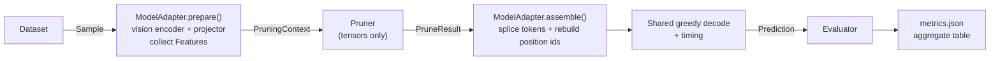

<div align="center">

# ✂️ Visual-Token-Pruning-Benchmark

[](https://www.python.org/)
[](https://pytorch.org/)
[](https://developer.nvidia.com/cuda-toolkit)
[](https://github.com/huggingface/transformers)
[](LICENSE)

**_How many visual tokens does a multimodal LLM actually need — and which ones?_**

A unified framework for benchmarking **visual token pruning methods** across **multimodal LLMs**, **vision-language benchmarks** and **token budgets**. It is reproducible and extensible, and it is set up for research use.

</div>

---

## 🤔 Why This Matters

MLLMs turn an image into hundreds or thousands of visual tokens (576 for LLaVA-1.5, 2,880 for LLaVA-NeXT at 672×672, over 10K for a 64-frame video). Text prompts are usually only a few dozen tokens long. Attention cost grows quadratically with sequence length, so the visual tokens dominate inference cost.

> **Vanilla:** Qwen2.5-VL-3B, 576 visual tokens → prefill **71.8 ms**
> **CDPruner:** same model, 64 visual tokens kept → prefill **17.4 ms**, **97.3%** of vanilla POPE F1
>
> Same model. Same weights. 89% fewer visual tokens. *(60-sample smoke run on an RTX 5070.)*

Pruning methods differ in what they look at: LLM text-visual attention (FastV, SparseVLM), vision-encoder attention (VisionZip, PruMerge), feature similarity (DivPrune, DART) or conditional diversity (CDPruner). Papers evaluate them on different codebases, prompts and model versions. This project runs every method through **one pipeline** so the comparison is fair.

---

## 📋 Prerequisites

| Requirement | Minimum Spec |
|---|---|
| OS | Ubuntu 24.04.5 LTS |
| GPU | NVIDIA GPU with ≥ 12 GB (developed on RTX 5070 12 GB; fp16 7B/13B models need ≥ 24 GB, or use the `_4bit` configs) |
| CUDA | PyTorch wheels for CUDA 12.8 (required for RTX 50-series / sm_120) |
| Python | 3.11 via Conda |
| Disk | ~10 GB for Qwen2.5-VL-3B plus the benchmark datasets (Hugging Face cache) |

---

## 🗂️ Pruning Methods

| # | Method | Config | Stage | Key Idea | Needs | Reference | Status |
|---|---|---|---|---|---|---|---|
| 0 | **Vanilla** | `vanilla` | — | Keep all visual tokens (upper bound) | — | — | ✅ |
| 1 | **Random** | `random` | pre-LLM | Uniformly random subset, seeded per sample | — | — | ✅ |
| 2 | **Pooling** | `pooling` | pre-LLM | Adaptive 2D average pooling of the token grid | grid | — | ✅ |
| 3 | **DivPrune** | `divprune` | pre-LLM | Max-Min Diversity Problem, greedy selection | — | [Alvar et al., CVPR 2025](https://arxiv.org/abs/2503.02175) | ✅ |
| 4 | **DPPruner** | `dppruner` | pre-LLM | DPP over feature similarity only (CDPruner ablation) | — | [Zhang et al., NeurIPS 2025](https://github.com/Theia-4869/CDPruner) | ✅ |
| 5 | **CDPruner** | `cdpruner` | pre-LLM | DPP with instruction-conditioned kernel `diag(r)·L·diag(r)` | instruction embedding (CLIP if available) | [Zhang et al., NeurIPS 2025](https://github.com/Theia-4869/CDPruner) | ✅ |
| 6 | **VisionZip** | `visionzip` | pre-LLM | [CLS] + dominant tokens by [CLS] attention, plus merged contextual tokens | [CLS] encoder (LLaVA-1.5) | [Yang et al., CVPR 2025](https://arxiv.org/abs/2412.04467) | ✅ |
| 7 | **LLaVA-PruMerge+** | `prumerge_plus` | pre-LLM | [CLS]-attention outliers + spatial samples, kNN merging | [CLS] encoder (LLaVA-1.5) | [Shang et al., 2024](https://arxiv.org/abs/2403.15388) | ✅ |
| 8 | **TRIM** | `trim` | pre-LLM | CLIP image–text similarity, top tokens + one aggregated token | CLIP text encoder (`llava_1_5_7b_clip*`) | [Song et al., COLING 2025](https://arxiv.org/abs/2409.10994) | ✅ |
| 9 | **FastV** | `fastv` | in-LLM | Drop visual tokens with low last-token attention before layer K | any model | [Chen et al., ECCV 2024](https://arxiv.org/abs/2403.06764) | ✅ |
| 10 | **PyramidDrop** | `pdrop` | in-LLM | Attention-based dropping at several layers, shrinking per stage | any model | [Xing et al., CVPR 2025](https://arxiv.org/abs/2410.17247) | ✅ |
| 11 | **DART** | `dart` | in-LLM | Key-norm pivot tokens, keep the tokens least similar to them | any model | [Wen et al., 2025](https://arxiv.org/abs/2502.11494) | ✅ |
| 12 | **SparseVLM** | — | in-LLM | Text-guided rater tokens + token recycling | — | [Zhang et al., ICML 2025](https://arxiv.org/abs/2410.04417) | 🚧 |

<details>
<summary><strong>Implementation fidelity</strong></summary>

Each method was checked line by line against its official repository. The table lists the details that matter but are **not in the papers**, plus our deliberate deviations:

| Method | Detail taken from the official code | Our deviation |
|---|---|---|
| CDPruner | Kernel built from projector tokens. On LLaVA, relevance uses CLIP embeddings of the select-layer (−2) patches (`post_layernorm` → `visual_projection`) vs. the pooled CLIP text embedding, **negated** (`relevance = (-relevance).mean(-1)`). | No official code for non-CLIP models. There we use projector tokens vs. the mean LLM embedding of the question, **not** negated: on Qwen2.5-VL-3B (POPE, 100 samples, 64 tokens) F1 is 78.9 without negation and 64.0 with it. |
| TRIM | Negated raw dot product of CLIP patch embeddings with the pooled text embedding, then softmax; the mean of the rest is appended as one token. | Fixed budget: top `budget−1` + 1 aggregated token instead of the adaptive IQR count. |
| VisionZip | [CLS] is kept as one of the dominant tokens (`dominant=54` → 53 patches + [CLS]). Keys are averaged over heads. Contextual = target + mean(assigned). | — |
| PruMerge+ | [CLS] attention uses the select layer's q/k as a single full-width head. Each kept token gets x + Σ aⱼxⱼ over its 32 nearest tokens. One extra attention-weighted token is added. | Fixed budget: `budget−1` tokens (outliers, then uniform fill) + 1 extra token. |
| DART | Pruning happens before layer K = 2, using layer K−1 outputs. Pivots are the 4 image + 4 text tokens with the largest L1 norm of post-RoPE keys; similarity uses final-normed hidden states. | Exactly `budget` tokens are kept. The official code keeps about budget + 4. |
| FastV | Last-token attention of layer K−1, averaged over heads, before layer K = 2. | — |
| PyramidDrop | Last-token attention at each stage. | Default stages `[2, 6, 12]` × 0.5 starting from `budget`, so the budget bounds compute. The paper's LLaVA setting is `[8, 16, 24]` × 0.5 from all tokens; it is configurable. |

In-LLM methods run our own layer-by-layer prefill. The pruned tokens are removed from the hidden states, the position ids and every later layer's KV cache, and the kept tokens keep their original positions. The attention is recomputed from q/k, so SDPA keeps working. `pytest -m gpu` checks it against HF eager attention weights (cosine > 0.999) and checks that the loop reproduces vanilla outputs when nothing is pruned.

</details>

## 🤖 Models

| Model | Adapter | Config | Visual tokens (input) | Encoder features exposed | Status |
|---|---|---|---|---|---|
| Qwen2.5-VL-3B | `qwen2_5_vl` | `qwen2_5_vl_3b` | 576 (672×672) | grid | ✅ verified |
| Qwen2.5-VL-7B | `qwen2_5_vl` | `qwen2_5_vl_7b` | 1,296 (1008×1008) | grid | ✅ config (≥ 24 GB) |
| LLaVA-1.5-7B | `llava` | `llava_1_5_7b` / `llava_1_5_7b_4bit` | 576 (336×336) | grid, [CLS] attention, keys, pre-projector features | ✅ verified (4-bit) |
| LLaVA-1.5-13B | `llava` | `llava_1_5_13b` | 576 | same as 7B | ✅ config (≥ 32 GB) |
| LLaVA-NeXT-7B | `llava_next` | `llava_next_7b` / `llava_next_7b_4bit` | 2,928 (672×672, anyres + newlines) | — | ✅ verified (4-bit) |
| LLaVA-NeXT-13B | `llava_next` | `llava_next_13b` | 2,928 | — | ✅ config (≥ 32 GB) |
| LLaVA-OneVision-0.5B | `llava_onevision` | `llava_ov_0_5b` | 1,485 (384×384, anyres) | — | ✅ verified |
| LLaVA-OneVision-7B | `llava_onevision` | `llava_ov_7b` | 1,485 | — | ✅ config (≥ 24 GB) |
| InternVL3-2B | `internvl` | `internvl3_2b` | 256 (one 448×448 tile) | grid | ✅ verified |
| InternVL3-8B | `internvl` | `internvl3_8b` | 1,280 (896×896, 4 tiles + thumbnail) | — | ✅ config (≥ 24 GB) |
| Qwen3-VL / LLaVA-Video | — | — | — | DeepStack / video frames need extra handling | 🚧 |

"✅ verified" means `pytest -m gpu` passes on an RTX 5070. Our splice-and-decode loop reproduces HF `generate()` token-for-token with all tokens kept, and every declared feature is produced. "✅ config" checkpoints use the same adapter but have not been run on this GPU.

<details>
<summary><strong>Model notes</strong></summary>

- **`_4bit` configs** quantise only the LLM decoder to NF4 with bitsandbytes (`pip install -e ".[quant]"`). The vision tower, projector and LM head stay in fp16. They let 7B models run on a 12 GB GPU, but their scores are not directly comparable with fp16 numbers in papers.
- **Positions.** 1D-RoPE models (LLaVA, InternVL) re-number positions 0..L'−1 after pruning, as the reference implementations do. Qwen2.5-VL keeps the original M-RoPE positions of the kept tokens.
- **LLaVA-NeXT** yields 2,928 tokens at 672×672, not the 2,880 in CDPruner Table 2, because HF's anyres packing adds one newline token per row.
- **HF chat templates** omit LLaVA-1.5's "A chat between a curious human..." system prompt, so absolute scores can differ slightly from the original LLaVA repo.
- **Instruction embedding** (`text_embeds`) is the mean LLM input embedding of the question for every model. CDPruner's LLaVA setting uses the CLIP text encoder instead; that option is not implemented yet.

</details>

## 📊 Benchmarks

| Benchmark | Config | Split (size) | Evaluator | Headline Metric | Status |
|---|---|---|---|---|---|
| POPE | `pope` | test (9,000) | `pope` | F1, mean over adversarial / popular / random | ✅ |
| MME | `mme` | test (2,374) | `mme` | Perception score (max 2000); `cognition` / `total` also reported | ✅ |
| GQA | `gqa` | test-dev balanced (12,578) | `exact_match` | Accuracy | ✅ |
| TextVQA | `textvqa` | validation (5,000) | `vqa_accuracy` | VQA accuracy (10 answers, leave-one-out) | ✅ |
| VQAv2 | `vqav2` | validation (214K, ~7 GB) | `vqa_accuracy` | VQA accuracy | ✅ |
| ScienceQA-IMG | `scienceqa_img` | test (2,017) | `multiple_choice` | Accuracy | ✅ |
| MMBench-EN / CN | `mmbench_en` / `mmbench_cn` | dev (1,164 questions, 4,329 rotations) | `multiple_choice` | CircularEval accuracy | ✅ |
| VizWiz / MM-Vet / SEED-Bench | — | — | — | Need an evaluation server, a GPT judge, or a 27 GB download | 🚧 |

<details>
<summary><strong>Protocol notes</strong></summary>

- **Prompts** follow the LLaVA-1.5 evaluation scripts: "Answer the question using a single word or phrase." for open-ended VQA, and "Answer with the option's letter from the given choices directly." for multiple choice.
- **MME**: CDPruner reports perception, VisionZip reports perception + cognition. Set `primary_metric: total` in [`configs/datasets/mme.yaml`](configs/datasets/mme.yaml) to switch. Run the full split; on a subset, the score only sums the sub-tasks that are present.
- **TextVQA**: `ocr_reference: true` adds the LLaVA-1.5 "Reference OCR token: ..." line to the prompt. It is off by default because it hands the model text that pruning may have removed.
- **VQAv2**: papers report test-dev, which is scored on the EvalAI server. Local scoring uses the validation split.
- **MMBench**: the dev split already contains the CircularEval option rotations. `limit` samples whole questions, so each question's rotations stay together.
- **Answer parsing** is rule-based (no LLM judge). Its failure rate is reported as `failed_parse` in `metrics.json`.
- **Acc.** in `vtb aggregate` averages each dataset on a 0–100 scale (MME perception / 20), as in CDPruner Table 1.

</details>

---

## 🏗️ Architecture



```
src/vtb/
├── core/        registry.py (auto-discovery) · types.py (Sample / PruningContext / PruneResult / Feature) · config.py
├── models/      base.py (BaseVLMAdapter) · hf_base.py (shared HF adapter) · qwen2_5_vl.py · llava.py · internvl.py
├── methods/     base.py (PreLLMPruner / InLLMPruner) · simple.py · divprune.py · cdpruner.py · visionzip.py · prumerge.py · trim.py · fastv.py (FastV, PDrop) · dart.py
├── datasets/    base.py (BaseDataset) · pope.py · mme.py · gqa.py · vqa.py · multiple_choice.py
├── evaluators/  base.py (BaseEvaluator) · pope.py · mme.py · exact_match.py · vqa_accuracy.py · multiple_choice.py
├── profiling/   flops.py
└── runner/      experiment.py · io.py · aggregate.py
```

**Capability negotiation.** Each method declares the `Feature`s it `requires` and each model adapter declares the ones it `provides`. Incompatible pairs, such as VisionZip (needs [CLS] attention) with Qwen2.5-VL (no [CLS]), are skipped, and the reason is written to `metrics.json`.

| Feature | Meaning | Used by |
|---|---|---|
| `visual_tokens` | Projector output `[N, D]` | all |
| `text_embeds` | Mean LLM input embedding of the question | CDPruner |
| `grid_shape` | Spatial layout of tokens | Pooling |
| `vision_feats` / `projector` | Pre-projector features + the projector, to merge before projecting | VisionZip, PruMerge+, TRIM |
| `vision_attn` / `vision_keys` / `vision_qk` / `cls_token` | Select-layer encoder internals ([CLS] attention, keys, raw q/k, [CLS] feature) | VisionZip, PruMerge+ |
| `clip_image_embeds` / `clip_text_embeds` | CLIP joint-space patch / instruction embeddings | TRIM, CDPruner (LLaVA) |
| `llm_attn` | Layer-by-layer prefill for in-LLM pruning | FastV, PyramidDrop, DART |

---

## ⚡ Quick Start

### Step 1 — Create Environment

```bash
conda create -n VTB python=3.11 -y
conda activate VTB
pip install torch torchvision --index-url https://download.pytorch.org/whl/cu128
pip install -e ".[dev]"
pip install -e ".[quant]"   # optional: bitsandbytes for the *_4bit model configs
```

### Step 2 — Run Your First Evaluation

```bash
# List registered models / methods / datasets / evaluators
vtb list

# POPE, 60 samples x {vanilla, random, DivPrune, CDPruner} @ 64 tokens (~1 min on an RTX 5070)
vtb run configs/experiments/smoke.yaml

# Paper-style table: per-dataset score, Acc., Rel. (vs. vanilla), prefill latency
vtb aggregate outputs/smoke
```

Model weights and datasets are downloaded from the Hugging Face Hub on first use (`Qwen/Qwen2.5-VL-3B-Instruct`, `lmms-lab/POPE`).

---

## 🧪 Reproduce the Experiments

Every experiment is a YAML file under [`configs/experiments/`](configs/experiments/). It expands into **models × datasets × methods × budgets**, and each model is loaded only once:

```bash
vtb run configs/experiments/pope_qwen3b.yaml
```

| Config | What it runs |
|---|---|
| [`smoke.yaml`](configs/experiments/smoke.yaml) | Qwen2.5-VL-3B · POPE (60) · vanilla / random / DivPrune / CDPruner @ 64 |
| [`smoke_all.yaml`](configs/experiments/smoke_all.yaml) | Qwen2.5-VL-3B · all 7 benchmarks, small subsets · vanilla / CDPruner @ 64 (~5 min) |
| [`methods_smoke.yaml`](configs/experiments/methods_smoke.yaml) | LLaVA-1.5-7B (+CLIP, 4-bit) and Qwen2.5-VL-3B · POPE (100) · all 12 methods @ 64 |
| [`models_smoke.yaml`](configs/experiments/models_smoke.yaml) | 5 local models · POPE (100) · vanilla / pooling / DivPrune / CDPruner @ 64, incl. capability-based skips |
| [`pope_qwen3b.yaml`](configs/experiments/pope_qwen3b.yaml) | Qwen2.5-VL-3B · POPE (900) · all pre-LLM methods @ 192 / 128 / 64 |
| [`table1_qwen3b.yaml`](configs/experiments/table1_qwen3b.yaml) | Qwen2.5-VL-3B · all 7 benchmarks · all pre-LLM methods @ 192 / 128 / 64 (CDPruner Table 1 layout) |

Results land in `outputs/<experiment>/<model>/<dataset>/<method>_<budget>/`:

- `predictions.jsonl` has one record per sample. Interrupted runs resume where they stopped.
- `metrics.json` has scores, efficiency (vision / prune / prefill / decode ms, prefill TFLOPs, peak memory) and the fully resolved config.

<details>
<summary><strong>Overriding settings from the command line</strong></summary>

Any key can be overridden with an OmegaConf dotlist:

```bash
vtb run configs/experiments/pope_qwen3b.yaml \
  dataset_overrides.limit=300 \
  generation.max_new_tokens=16 \
  model_overrides.image_size=[448,448]
```

Recompute metrics from saved predictions, for example after changing an evaluator:

```bash
vtb score outputs/smoke/qwen2_5_vl_3b/pope/cdpruner_64
```

</details>

<details>
<summary><strong>Tests</strong></summary>

```bash
pytest          # unit tests: methods on synthetic tensors, evaluators on hand-written cases
pytest -m data  # load every dataset config (needs the HF cache)
pytest -m gpu   # end-to-end, every local model: vanilla output must match HF generate() token-for-token
pytest -m gpu -k llava_ov   # a single model
```

Every registered pre-LLM method is automatically checked against a shared contract in [`tests/methods/test_pre_llm_methods.py`](tests/methods/test_pre_llm_methods.py): output size ≤ budget, sorted and unique indices, determinism, and identity at full budget.

</details>

---

## 🔧 Extending the Framework

The framework uses a **Registry Pattern** with auto-discovery: drop a file into the package and add a YAML config. Existing code never has to change.

### Add a New Pruning Method

```python
# 1. Create src/vtb/methods/my_method.py
from vtb.core.registry import METHODS
from vtb.core.types import Feature, PruneResult, PruningContext
from vtb.methods.base import PreLLMPruner

@METHODS.register("my_method")
class MyMethod(PreLLMPruner):
    requires = frozenset({Feature.VISUAL_TOKENS, Feature.TEXT_EMBEDS})

    def prune(self, ctx: PruningContext) -> PruneResult:
        keep = ...  # at most ctx.budget indices
        return PruneResult.select(ctx.visual_tokens, keep)
```

```yaml
# 2. Create configs/methods/my_method.yaml
type: my_method
budgets: [192, 128, 64]
params: {}          # forwarded to __init__
```

An **in-LLM** method subclasses `InLLMPruner` instead. It says at which decoder layers to prune, and picks tokens from an `LLMLayerContext`, which carries hidden states, last-token attention, and optionally keys. The adapter handles hidden states, positions and the KV cache:

```python
@METHODS.register("my_in_llm")
class MyInLLM(InLLMPruner):
    needs_attention = True   # fill ctx.last_token_attn (layer K-1)
    needs_keys = False       # fill ctx.key_states / ctx.normed_hidden

    def schedule(self, num_visual, num_layers):
        return [(2, self.budget)]                      # prune right before layer 2

    def select(self, ctx):
        return ctx.visual_attn.topk(ctx.budget).indices  # indices into ctx.visual_positions
```

Every registered method is checked against a shared contract in `tests/methods/` (budget, valid and unique indices, determinism, schedule sanity).

### Add a New Model

Most HF `*ForConditionalGeneration` VLMs work with the shared `HFVLMAdapter`. It handles the processor, `get_image_features()`, splicing the pruned tokens back in, and the decode loop. A new family only declares what it can expose:

```python
# 1. Create src/vtb/models/my_vlm.py
from vtb.core.registry import MODELS
from vtb.core.types import Feature
from vtb.models.hf_base import HFVLMAdapter

@MODELS.register("my_vlm")
class MyVLMAdapter(HFVLMAdapter):
    provides = frozenset({Feature.VISUAL_TOKENS, Feature.TEXT_EMBEDS, Feature.GRID_SHAPE})

    def extra_features(self, inputs, visual_tokens, vision_out):
        return {Feature.GRID_SHAPE: (24, 24)}   # anything beyond projector tokens + instruction embedding

    # optional overrides:
    #   position_ids() / reindex_positions   for non-1D RoPE (see qwen2_5_vl.py)
    #   before_vision() / after_vision()     to capture encoder attention (see llava.py)
```

```yaml
# 2. Create configs/models/my_vlm_7b.yaml
type: my_vlm
pretrained: org/my-vlm-7b
dtype: bfloat16
image_size: [672, 672]   # optional fixed input resolution
quantization: null       # or 4bit / 8bit
```

Another size of an existing family only needs a new YAML. For a model that does not follow the HF layout, subclass `BaseVLMAdapter` directly and implement `load / prepare / assemble / lm_step` and the related methods. Add the config to `LOCAL_MODELS` in [`tests/test_smoke_e2e.py`](tests/test_smoke_e2e.py) and run `pytest -m gpu -k my_vlm`. The test checks that the vanilla output matches HF `generate()` and that every declared feature is produced.

### Add a New Benchmark

```python
# 1. Create src/vtb/datasets/my_bench.py
from vtb.core.registry import DATASETS
from vtb.core.types import Sample
from vtb.datasets.base import BaseDataset

@DATASETS.register("my_bench")
class MyBench(BaseDataset):
    evaluator = "exact_match"   # any registered evaluator
    prompt_suffix = "Answer the question using a single word or phrase."

    def to_sample(self, row: dict, idx: int) -> Sample:  # idx = row index in the full split
        return Sample(id=str(row["id"]), images=[row["image"]],
                      question=row["question"], answers=[row["answer"]])
```

Multiple-choice benchmarks can subclass `MultipleChoiceDataset` instead, which builds the `A. ... / B. ...` prompt from `Sample.choices`. To change how `limit` picks rows, for example to keep groups together, override `subset_indices()`. To join several HF configs, override `load_rows()`, as GQA does.

```yaml
# 2. Create configs/datasets/my_bench.yaml
type: my_bench
path: org/my-bench      # Hugging Face Hub dataset
split: test
data_files: data/test-* # optional: download only this split
primary_metric: null    # optional: override the evaluator's headline metric
limit: null
```

If the benchmark needs new scoring logic, subclass `BaseEvaluator` in `src/vtb/evaluators/` and register it with `@EVALUATORS.register(...)`.

---

## 🛑 U.S. Export Control & Sanctions Compliance

By downloading, installing, copying, accessing, or using this repository (including but not limited to the source code, frameworks, documentation, and token pruning benchmarking assets), you agree to comply with all applicable export control and economic sanctions laws.

### Restricted Usage & Prohibitions
* **Prohibited Entities:** This software is strictly prohibited from being used, directly or indirectly, by any entity or individual listed on any United States Government restricted lists, including but not limited to the **OFAC Specially Designated Nationals (SDN) List** and the **Bureau of Industry and Security (BIS) Entity List**.
* **Prohibited Destinations:** This repository shall not be exported, re-exported, transferred, or accessed within any U.S.-embargoed or sanctioned countries or territories (including Russia, Belarus, Iran, North Korea, Cuba, Syria, and the Crimea, Donetsk, and Luhansk regions of Ukraine).
* **Military & Defense Restrictions:** This software shall not be utilized for military purposes, defense applications, or any activity that contributes to the modernization of foreign military forces or intelligence systems subject to global trade restrictions.

*Failure to comply with these terms constitutes a material violation of the repository's terms of use, and any license granted herein shall be automatically terminated and revoked void ab initio.*
